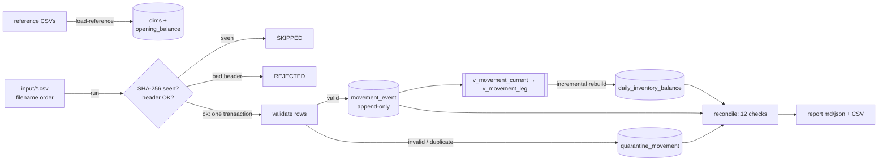

# Inventory Daily Balance Pipeline

Turns inventory movement events (receipts, issues, transfers, adjustments) from CSV batch files into a
**dense daily balance table** per SKU and location. It reconciles every movement total, quarantines invalid
rows with full traceability, and recomputes history correctly when late or backdated corrections arrive.

Python 3.10+ standard library + SQLite. No services, no credentials. The only dependency is `pytest`, for the tests.

## Quick start

```bash
git clone https://github.com/risri-odoo/inventory-daily-balance-pipeline.git
cd inventory-daily-balance-pipeline

python -m venv .venv
# Windows (PowerShell):   .venv\Scripts\Activate.ps1      (cmd.exe: .venv\Scripts\activate.bat)
# Linux / macOS:          source .venv/bin/activate
pip install -r requirements.txt

python -m inventory_pipeline demo     # fresh DB -> sample reference -> 2 sample batches -> reconcile -> report
pytest -q                             # 179 tests
```

> **If `python -m venv` cannot install pip** (e.g. Debian/Ubuntu without `python3-venv`): install it
> (`sudo apt install python3-venv`), or skip the venv and run `python -m pip install --user pytest`.
> The pipeline itself needs nothing beyond Python, so `python -m inventory_pipeline demo` works even
> without pytest.

**Expected demo output** (abridged; run ids and times differ; full output in
[docs/evidence/demo_output.txt](docs/evidence/demo_output.txt)):

```
... event=run_finished ... source_file=batch_01.csv status=SUCCESS rows_read=17 rows_accepted=8 rows_rejected=8 rows_duplicate=1 rows_late=0 ...
... event=run_finished ... source_file=batch_02.csv status=SUCCESS rows_read=14 rows_accepted=10 rows_rejected=4 rows_duplicate=0 rows_late=4 rows_superseding=2 ...
... level=WARNING event=check name=negative_balances status=WARN failures=2 details="2 negative rows across 1 pairs"
... event=reconciliation_finished status=WARN
... event=demo_finished files=2 bad_runs=0 reconciliation=WARN exit_code=0
```

All 11 other checks are PASS. The one WARN is deliberate: the sample contains a pair (SKU-003 @ WH-01)
that is issued stock it never received. Results go to `output/`: `demo.db`,
`reconciliation_report.md/.json`, `daily_inventory_balance.csv`, `quarantine_movement.csv`,
`pipeline_run.csv`, `dashboard.html` and `logs/pipeline.log`.

## Dashboard (read-only, offline)

`demo` also writes **`output/dashboard.html`**, a single self-contained file (inline CSS and JavaScript, data
embedded, no external URLs, no server). Open it by double-clicking it, or from the terminal:

```bash
# Windows:  start output\dashboard.html      macOS:  open output/dashboard.html      Linux:  xdg-open output/dashboard.html
python -m inventory_pipeline dashboard --db output/demo.db --out output/dashboard.html   # rebuild it for any database
```

It shows:
- the overall reconciliation status, headline counts and horizon;
- one card per check, with example rows;
- the run log in the order runs started;
- rejects by reason, plus a filterable quarantine table;
- a **balance explorer**: pick a SKU and location to see a closing-quantity chart and the daily table, with
  negative days highlighted;
- **movement history**: type a `movement_id` to see every version, which one is current, and the arrival
  order. Try `MV-1005`: v3 arrived before v2.

The dashboard only reads the database. It is meant for review-sized databases: every row is embedded, so for
the 100k benchmark database the file is about 14 MB.

## Architecture



Every run is recorded in `pipeline_run` (RUNNING, then SUCCESS / SKIPPED / REJECTED / FAILED, with counts,
stage timings and errors). Details: [docs/architecture.md](docs/architecture.md).

## Commands

All commands are `python -m inventory_pipeline <command>`. Paths come from `--db` / `--output-dir`, or the
env vars `INV_DB_PATH` / `INV_OUTPUT_DIR` (defaults: `output/inventory.db` and `output/`).

| Command | What it does |
|---------|--------------|
| `init` | Create the tables and views (safe to repeat) |
| `load-reference --ref-dir DIR` | Upsert `dim_sku.csv`, `dim_location.csv`, `opening_balance.csv`. Reload = no-op; a changed opening balance triggers a full rebuild |
| `run --input FILE_OR_DIR [--force] [--full-rebuild] [--fail-at after_load\|after_rebuild]` | Process one file or every `*.csv` in a folder (filename order) |
| `reconcile` | Run the 12 checks and log PASS / FAIL / WARN |
| `report [--out DIR]` | Reconcile, then write `reconciliation_report.md/.json` and CSV exports |
| `dashboard [--out FILE]` | Write the read-only, offline HTML dashboard (default `<output-dir>/dashboard.html`) |
| `generate [--rows 100000] [--seed 42] [--out data/generated] ...` | Synthetic data + oracle labels (see `--help` for SKUs, locations, days, batches, defect rates) |
| `demo [--output-dir DIR]` | Recreate `<output-dir>/demo.db`, load the sample, reconcile, report, write the dashboard |

Exit code: **1** if any run is FAILED or REJECTED, or any check FAILS; otherwise 0 (a WARN is 0).

Example of a full manual run:

```bash
python -m inventory_pipeline init
python -m inventory_pipeline load-reference --ref-dir data/sample/reference
python -m inventory_pipeline run --input data/sample/input
python -m inventory_pipeline report
```

Larger run and benchmark:

```bash
python -m inventory_pipeline generate --rows 100000 --seed 42 --out data/generated/big
python scripts/benchmark.py            # writes docs/benchmark.md and docs/evidence/benchmark_results.json
```

## Rerun, retry and backfill

| Situation | What happens |
|-----------|--------------|
| **Same file again** | `SKIPPED`: its SHA-256 is in `processed_file`. Nothing is written except the run row |
| **Same file with `--force`** | Reprocessed. Every previously loaded row is a `DUPLICATE_EVENT` (or rejected again); balances unchanged |
| **Same rows in a new file** | Caught by the `(movement_id, version)` key: identical payload = duplicate (dropped, counted), different payload = `CONFLICTING_DUPLICATE` (rejected); the first arrival wins |
| **Crash or error mid-file** | One transaction per file, so ROLLBACK. The run is `FAILED` with `error_message`, and nothing else is kept. **Retry = run the same command again.** A folder run stops at the first FAILED file so later batches never jump ahead. Try it: `run --input ... --fail-at after_rebuild` |
| **Bad header** | `REJECTED` (missing required column or duplicate column name). Fix the file at the source; later files still run |
| **Late / backdated rows** | Accepted and flagged `is_late`. Balances are recomputed from the earliest affected date for each affected pair |
| **Corrections** | A higher `version` of the same `movement_id` becomes current, whatever the arrival order. Older versions stay in history |
| **Changed opening balance** | `load-reference` detects it and rebuilds all balances |
| **Rebuild from scratch** | `run --full-rebuild`, or delete the DB and reload. Results are deterministic |

## Output tables

| Table / view | Grain | Purpose |
|--------------|-------|---------|
| `daily_inventory_balance` | sku × location × day, dense to the latest business date | **The output:** opening, receipts, issues, transfers in/out, adjustments, net change, closing |
| `movement_event` | movement_id × version | Append-only history of accepted rows, with `payload_hash`, `is_late`, `run_id`, `source_file`, `source_line` |
| `v_movement_current` | movement_id | Highest version of each movement |
| `v_movement_leg` | leg | Signed ledger legs (a transfer is a `TRANSFER_OUT` leg and a `TRANSFER_IN` leg) |
| `quarantine_movement` | rejected row | Reason, every failure (JSON), original line, file and line number |
| `pipeline_run` | run | Status, counts, late/superseding rows, rebuild stats, negative rows, schema warnings, stage timings, error |
| `processed_file` | file SHA-256 | Successfully processed files (re-run skip) |
| `dim_sku`, `dim_location`, `opening_balance` | | Reference data |

Column-level detail: [docs/data_dictionary.md](docs/data_dictionary.md). Example queries:
[sql/sample_queries.sql](sql/sample_queries.sql).

**Naming:** `snake_case`. Dates are `YYYY-MM-DD`; timestamps are UTC `...Z`. `run_id` =
`run-<UTC time>-<8 hex>`. `source_file` is stored relative to the input folder, so no machine paths are kept.

## Documentation

| Doc | Contents |
|-----|----------|
| [docs/assignment.md](docs/assignment.md) | The original problem statement |
| [docs/architecture.md](docs/architecture.md) | Flow diagram, module responsibilities |
| [docs/data_dictionary.md](docs/data_dictionary.md) | Every source column, table, key, null rule and derived field |
| [docs/design_notes.md](docs/design_notes.md) | Decisions and trade-offs (SQLite, dense grid, versions, incremental, negative stock, idempotency) |
| [docs/assumptions_and_deviations.md](docs/assumptions_and_deviations.md) | Every assumption (A1–A32) and deviation |
| [docs/verification.md](docs/verification.md) | Each acceptance criterion mapped to the tests and checks that prove it |
| [docs/benchmark.md](docs/benchmark.md) | 100k-row timings, the optimization measured, next steps |
| [docs/walkthrough.md](docs/walkthrough.md) | A record traced end to end, likely reviewer questions |
| [data/sample/expected/README.md](data/sample/expected/README.md) | The hand-computed answer key for the sample |
| [docs/evidence/](docs/evidence/README.md) | Real outputs: pytest, demo, reconciliation report, benchmark |

## How it was tested

- **179 pytest tests:**
  - one per validation rule and boundary;
  - end to end on a hand-made sample whose expected balances, rejects and run counts were worked out by hand;
  - idempotency (skip, `--force`, incremental = full rebuild);
  - partial failure and retry;
  - late, out-of-order and location-changing corrections;
  - every edge-case file;
  - generator determinism and agreement with the generator's oracle labels.
- **12 reconciliation checks,** including an independent SQL window-sum recompute. Each check has a test
  that corrupts the data and proves the check fails.
- **100,000 generated rows:** reconciliation PASS, and rejects, per-batch counts and final balances equal the
  oracle exactly ([docs/benchmark.md](docs/benchmark.md)).

## Known limitations and next steps

- **Single writer / single core** (SQLite), and row-by-row validation: about 4,500 rows/s for 100k rows on a
  laptop, slowing as history grows. Next: bulk key lookups, date-filtered ledger reads, DuckDB, and monthly
  partitions of the balance table.
- **The dense grid grows with pairs × days.** At large scale, store sparse rows and expose a dense view.
- **One CSV record per line** (no multi-line quoted values), so `source_line` and `raw_record` stay exact.
- **Reference data is upsert-only** (no deletes or effective dating). Any opening-balance change triggers a
  full rebuild.
- **The generator's corrections only increase quantities** and its late rows are issues, so the true stock
  never goes negative. Negative-stock behaviour is covered by the hand-made sample.
- **Evidence was captured on Windows 11 / Python 3.13.** The code targets Python 3.10+ and Linux (pathlib,
  LF line endings, no shell scripts), but no Linux or 3.10 run is included.

## AI usage

This project was built with Claude Code from a detailed specification written by the candidate. Every prompt
is in [prompt_history/](prompt_history/). [AI_USAGE.md](AI_USAGE.md) lists what was AI-generated, the
problems found during the build, and the candidate's own account of what they reviewed, changed and
validated.
