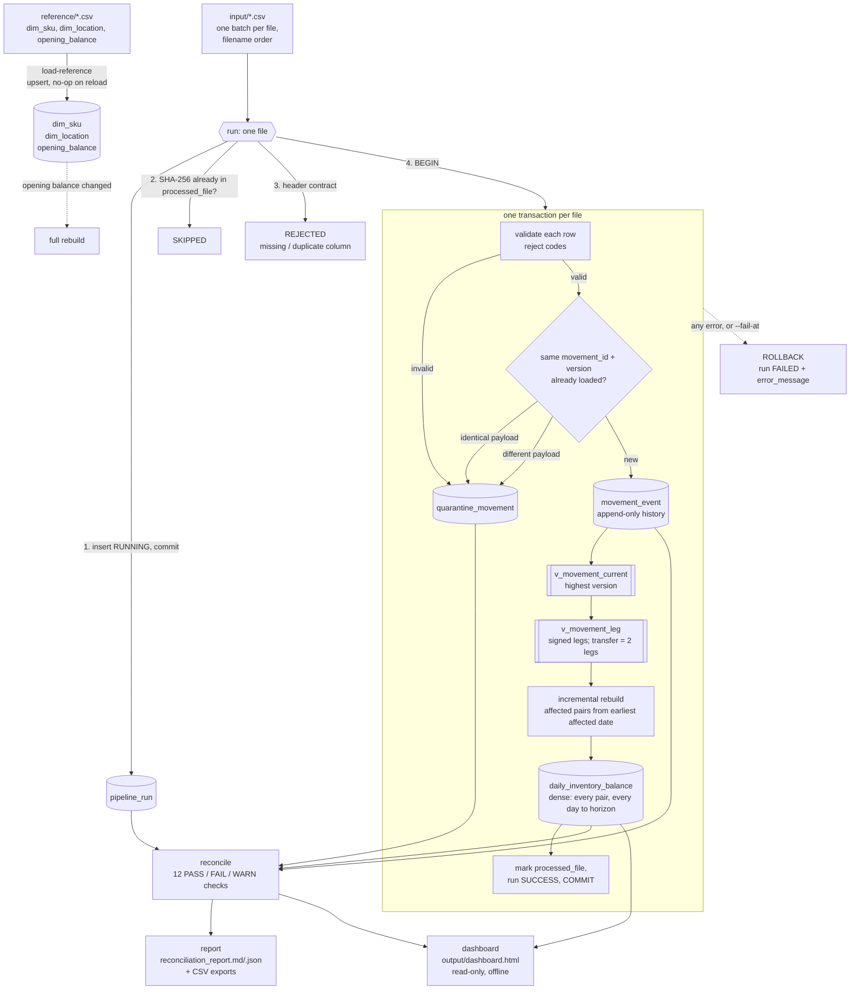
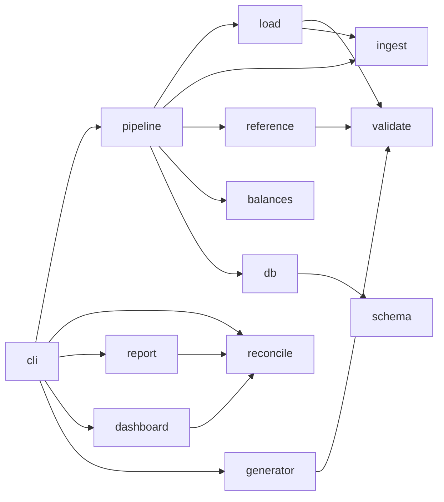

# Architecture

A single-process Python pipeline (standard library only) with SQLite as both storage and target.
There are no services to run: everything is one package, one database file and plain CSV in and out.

## Flow

The dashboard (`dashboard.py`) is a read-only view for walkthroughs. It reads the same tables and runs the
same checks as `report`, and writes nothing to the database.

## Module responsibilities

All modules live in `inventory_pipeline/`. Each one does one job and can be read on its own.

| Module | Responsibility | Key functions |
|--------|----------------|---------------|
| `config.py` | Default paths from env vars (`INV_DB_PATH`, `INV_OUTPUT_DIR`) | `default_db_path`, `default_output_dir` |
| `schema.py` | Every `CREATE TABLE / INDEX / VIEW` statement, as commented SQL | `ALL_STATEMENTS`, `TABLE_NAMES` |
| `db.py` | Connection (autocommit), schema creation, explicit transactions | `connect`, `init_db`, `transaction` |
| `reference.py` | Read and upsert the three reference files; raise on bad master data | `load_reference_files`, `fetch_reference_data` |
| `ingest.py` | Read a movement file: SHA-256, header contract, raw rows with line numbers | `read_movement_file`, `check_header`, `file_sha256` |
| `validate.py` | Pure row validation: every rule, every reject code, payload hash | `validate_row`, `quantity_error` |
| `load.py` | Duplicate detection, append to history, current vs. history-only, late flag, affected pairs | `load_rows` |
| `balances.py` | Dense daily balances: pure row builder, per-pair rebuild, incremental and full rebuild | `build_pair_rows`, `rebuild_pair`, `incremental_rebuild`, `full_rebuild` |
| `pipeline.py` | Orchestration of one run: RUNNING → SKIPPED / REJECTED / transaction → SUCCESS / FAILED | `run_file`, `run_input`, `run_load_reference` |
| `reconcile.py` | Independent SQL checks over the finished tables | `run_reconciliation`, `check_*` |
| `report.py` | Reconciliation report (Markdown + JSON) and CSV exports | `write_report` |
| `dashboard.py` | Read-only, offline, single-file HTML dashboard: static sections rendered and escaped in Python, interactive sections drawn by vanilla JS from safely embedded JSON | `write_dashboard`, `collect_data`, `safe_json` |
| `logs.py` | `key=value` log lines to console and `output/logs/pipeline.log` | `setup_logging`, `log_event` |
| `generator.py` | Seeded synthetic data with oracle labels | `generate` |
| `cli.py` | `python -m inventory_pipeline <command>` | `main` |

`scripts/benchmark.py` drives the generator and pipeline to measure performance.

## Dependencies between modules

## Key design points (details in [design_notes.md](design_notes.md))

- **History is append-only.** `movement_event` is only ever inserted into. Corrections are new versions,
  and the views pick the highest version. Nothing is overwritten, so any past state can be explained.
- **One transaction per file.** A file either lands completely (events, rejects, balances, processed
  marker, run status) or not at all. The `RUNNING` row is committed *before* the transaction, so a
  crash is still visible.
- **Two layers of idempotency.** The file hash skips a byte-identical re-run. The `(movement_id, version)`
  key makes any re-sent row a duplicate, even inside a new file or with `--force`.
- **Balances are derived, never edited by hand.** They can always be rebuilt from history
  (`--full-rebuild`). The incremental path is an optimization, and a test proves it gives the same table.
- **Checks are independent.** `reconcile.py` recomputes in SQL (window functions) rather than calling
  the Python rebuild, so a bug in one shows up against the other.
